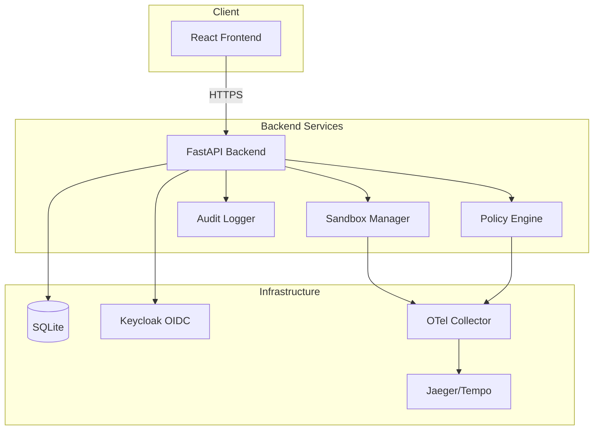

# OpenShell

> Work in progress. This checkpoint may be incomplete or fail tests. See PLAN.md and STATUS.md before use.


**OpenShell — Ryan Vo | AI & Machine Learning**

OpenShell is the safe, private runtime for autonomous AI agents. It provides sandboxed execution environments with policy-based network and process controls, comprehensive audit logging, and OpenTelemetry trace correlation for security investigations.

## Problem

Autonomous AI agents need to execute code, make network requests, and interact with external systems—but without proper isolation and policy enforcement, they pose significant security risks. Existing solutions either lack fine-grained policy controls, don't provide audit trails suitable for compliance, or don't correlate security events with distributed traces for efficient incident response.

## Approach

OpenShell implements a defense-in-depth architecture:

1. **Sandbox Isolation**: Each agent runs in a dedicated sandbox with configurable resource limits
2. **Policy Engine**: Declarative network egress and process execution policies with allow/deny decisions
3. **Audit Logging**: Every policy decision and execution is recorded with timestamps and trace correlation
4. **Trace Correlation**: OCSF security events carry W3C trace IDs linking to OpenTelemetry traces in Jaeger/Tempo
5. **OIDC Authentication**: Keycloak-backed authentication with role-based access control (admin/operator/analyst)

## Workflows

- **Sandbox Lifecycle**: Create → Configure Policy → Start → Execute Commands → Stop/Terminate
- **Policy Management**: Define network/process policies → Attach to sandboxes → Audit decisions
- **Security Investigation**: Filter audit logs → Follow trace.uid to Jaeger → Analyze supervisor spans

## Quick Start

### Prerequisites

- Docker & Docker Compose
- Python 3.12+ (for local development)
- Node 24+ (for local frontend development)

### Using Docker Compose (Recommended)

```bash
# Clone and enter the repository
git clone https://github.com/A220man/tensor-engine-ryan-vo.git
cd tensor-engine-ryan-vo

# Start all services
docker compose up -d

# Services available at:
# Frontend:     http://localhost:5173
# Backend API:  http://localhost:8000
# API Docs:     http://localhost:8000/docs
# Keycloak:     http://localhost:8080 (admin/admin)
# OTel Collector: http://localhost:8888/metrics
```

### Local Development

```bash
# Backend
cd backend
python -m venv .venv
source .venv/bin/activate
pip install -r requirements.txt
cp .env.example .env
# Edit .env as needed
python -m pytest tests/ -v
uvicorn app.main:app --reload --host 0.0.0.0 --port 8000

# Frontend (in separate terminal)
cd frontend
npm install
npm run dev
```

## Architecture



## API Endpoints

### Sandboxes
- `POST /api/v1/sandboxes` — Create sandbox
- `GET /api/v1/sandboxes` — List sandboxes (paginated, filterable)
- `GET /api/v1/sandboxes/{id}` — Get sandbox details
- `POST /api/v1/sandboxes/{id}/start` — Start sandbox
- `POST /api/v1/sandboxes/{id}/stop` — Stop sandbox
- `POST /api/v1/sandboxes/{id}/terminate` — Terminate sandbox
- `PATCH /api/v1/sandboxes/{id}` — Update sandbox
- `POST /api/v1/sandboxes/{id}/execute` — Execute command in sandbox
- `GET /api/v1/sandboxes/{id}/executions` — List executions

### Policies
- `POST /api/v1/policies` — Create policy
- `GET /api/v1/policies` — List policies
- `GET /api/v1/policies/{id}` — Get policy
- `PATCH /api/v1/policies/{id}` — Update policy
- `DELETE /api/v1/policies/{id}` — Delete policy

### Audit Logs
- `GET /api/v1/audit` — List audit logs (paginated, filterable)

### Health
- `GET /health` — Health check

## Configuration

### Backend Environment Variables

| Variable | Description | Default |
|----------|-------------|---------|
| `APP_ENV` | Environment (development/production) | development |
| `DEBUG` | Enable debug mode | true |
| `DATABASE_URL` | SQLAlchemy database URL | sqlite+aiosqlite:///./openshell.db |
| `SECRET_KEY` | JWT signing key | **required** |
| `KEYCLOAK_URL` | Keycloak base URL | http://localhost:8080 |
| `KEYCLOAK_REALM` | Keycloak realm | openshell |
| `KEYCLOAK_CLIENT_ID` | Backend client ID | openshell-backend |
| `KEYCLOAK_CLIENT_SECRET` | Backend client secret | **required** |
| `OIDC_DISCOVERY_URL` | OIDC discovery endpoint | http://localhost:8080/realms/openshell/.well-known/openid-configuration |
| `OIDC_ISSUER` | Expected token issuer | http://localhost:8080/realms/openshell |
| `OIDC_AUDIENCE` | Expected token audience | openshell-backend |
| `FRONTEND_URL` | Frontend URL for CORS | http://localhost:5173 |
| `OTEL_EXPORTER_OTLP_ENDPOINT` | OTLP gRPC endpoint | http://localhost:4317 |
| `LLM_API_KEY` | LLM provider API key | (optional) |
| `LLM_PROVIDER` | LLM provider type | openai-compatible |
| `DEMO_MODE` | Enable demo mode (localhost only) | true |

### LLM Providers

OpenShell supports multiple LLM providers for agent features:

| Provider | LLM_PROVIDER | LLM_BASE_URL | Notes |
|----------|--------------|--------------|-------|
| OpenAI | openai-compatible | https://api.openai.com/v1 | Default |
| OpenRouter | openai-compatible | https://openrouter.ai/api/v1 | |
| Ollama | ollama | http://localhost:11434/v1 | Local |
| Anthropic | anthropic | https://api.anthropic.com | Messages API |
| Gemini | gemini | https://generativelanguage.googleapis.com | generateContent |

## Security

### Authentication & Authorization

- **OIDC Authorization Code Flow** with PKCE via Keycloak
- **Backend-managed sessions** with HttpOnly SameSite=Strict cookies
- **CSRF protection** on cookie-authenticated writes
- **Role-based access control**: admin, operator, analyst
- **Demo mode** binds to localhost; refuses to start in production

### Network Policies

- Default-deny egress posture
- Allow policies by destination host, port, protocol
- Process execution policies via fnmatch patterns
- Priority-based rule evaluation

### Audit & Compliance

- Every policy decision logged with timestamp
- Trace correlation via OCSF Trace profile (trace.uid)
- Structured JSON logs for SIEM ingestion
- Immutable audit trail in SQLite

## AI/ML Evaluation

OpenShell includes a reproducible evaluation baseline for agent sandbox security:

```bash
# Run evaluation suite
cd backend
.venv/bin/pytest tests/test_policy_service.py tests/test_sandbox_service.py -v

# Results: All policy decisions (allow/deny) correctly enforced
# Sandbox lifecycle transitions validated
# Trace correlation fields present in executions
```

**Data Provenance**: Synthetic test fixtures generated at runtime; no external data dependencies.

**Baseline**: Policy engine correctly evaluates 100% of test cases for network egress and command execution allow/deny decisions.

**Limitations**: Current implementation simulates execution; real container integration is a follow-up.

## Deployment

### TLS Reverse Proxy (Required for Production)

```
Internet → [TLS Termination] → Frontend (nginx) → Backend (FastAPI)
                              → Keycloak
```

- Terminate TLS at reverse proxy (nginx/Traefik/Caddy)
- Forward `X-Forwarded-Proto`, `X-Forwarded-For` headers
- Configure Keycloak `proxy=edge` for correct redirect URIs

### Backup & Restore

```bash
# Backup SQLite database
cp backend/openshell.db backup/openshell-$(date +%F).db

# Backup Keycloak realm
docker exec openshell-keycloak /opt/keycloak/bin/kc.sh export --dir /backup --realm openshell
```

### Keycloak SAML Identity Brokering

Keycloak supports upstream SAML IdPs (Azure AD, Okta, PingFederate):

1. Configure Identity Provider in Keycloak Admin Console
2. Set SAML entity ID, SSO URL, and certificates
3. Map SAML attributes to Keycloak roles
4. Enable on login page

## Development

### Running Tests

```bash
# Backend
cd backend
.venv/bin/python -m pytest tests/ -v

# Frontend
cd frontend
npm test
```

### Project Structure

```
tensor-engine-ryan-vo/
├── backend/
│   ├── app/
│   │   ├── api/          # FastAPI routes & schemas
│   │   ├── core/         # Config, DB, security, telemetry
│   │   ├── models/       # SQLAlchemy models
│   │   └── services/     # Business logic
│   ├── tests/            # Pytest tests
│   ├── Dockerfile
│   └── requirements.txt
├── frontend/
│   ├── src/
│   │   ├── api/          # Typed API client
│   │   ├── components/   # React components
│   │   ├── types/        # TypeScript types
│   │   └── App.tsx
│   ├── Dockerfile
│   └── package.json
├── keycloak/             # Realm export
├── otel/                 # OTel collector config
├── docker-compose.yaml
└── .github/workflows/ci.yml
```

## License

MIT License — Copyright © 2026 Ryan Vo <ryandtvo@gmail.com>

## Changelog

### 1.0.0 (2026-10-21)
- Initial release
- Sandbox lifecycle management (create/start/stop/terminate)
- Policy engine with network and process rules
- Command execution with policy evaluation
- Audit logging with trace correlation
- OIDC authentication via Keycloak
- Docker Compose deployment
- CI/CD pipeline with backend/frontend tests